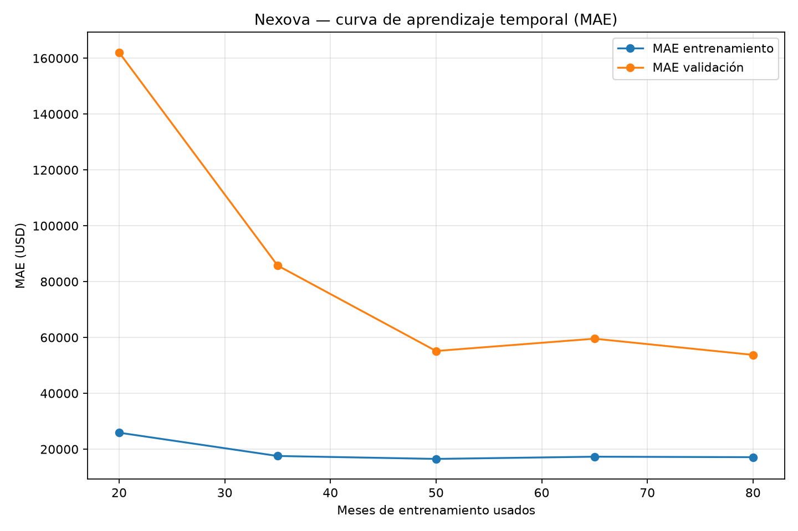

# Evaluación técnica del modelo de pronóstico de ingresos Nexova

## Veredicto

**Diagnóstico: overfitting.** En el último punto de la curva, MAE validación/train = 3.14×, por encima del umbral operativo >=1.50×; no se afirma persistencia porque la curva aún muestra sensibilidad al tamaño de entrenamiento. La variación entre folds de MAE de validación (desviación estándar/media) es 14.6%; interpretar con cautela por la muestra mensual pequeña.

La curva mantiene fijo el último bloque temporal de validación (los meses finales del set de entrenamiento) y amplía cronológicamente el prefijo de entrenamiento. La decisión se apoya en MAE, elegida como métrica principal porque representa directamente el error absoluto típico en USD y es más interpretable para planificar ingresos; RMSE se conserva para penalizar más los errores grandes. El briefing de empresa no define costos monetarios diferenciales por tipo de error, así que MAE es una elección operativa interpretable, no una estimación de pérdida financiera.

## Datos y protocolo

- Fuente: `data/raw/nexova_sales.csv`, objetivo `revenue_usd` de filas `consolidated`.
- Se evalúan los 96 meses 2016-01–2023-12; los 24 meses 2024–2025 del holdout final no participan en esta evaluación.
- Modelo: Random Forest con 500 árboles, `min_samples_leaf=2`, semilla 42; imputación dentro de un pipeline ajustado de nuevo por fold.
- Validación: `TimeSeriesSplit`, 5 folds expansivos, sin shuffle. En cada fold los índices de entrenamiento son anteriores a validación, y los bloques de validación avanzan en orden. Las pruebas automatizadas comprueban también que alterar el target y el futuro no cambia los features del objetivo.
- Features: calendario, lags 1/2/12 y medias rodantes 3/12 calculados para cada mes usando exclusivamente registros anteriores al mes objetivo. Durante cada bloque de validación se evalúa rolling one-step-ahead: observaciones reales anteriores dentro del bloque pueden alimentar lags de meses posteriores, sin reentrenar el modelo. Esto representa reforecast mensual, no predicción multi-horizonte sin observaciones intermedias.
- Las medias ± desviaciones estándar de CV describen cinco períodos de validación temporal distintos; no son intervalos de confianza estadísticos.

## Validación cruzada temporal

| Fold | Entrenamiento | Validación | Train MAE | Train RMSE | Validación MAE | Validación RMSE |
|---:|---|---|---:|---:|---:|---:|
| 1 | 2016-01–2017-04 (16) | 2017-05–2018-08 (16) | $24,984 | $33,960 | $47,864 | $62,017 |
| 2 | 2016-01–2018-08 (32) | 2018-09–2019-12 (16) | $18,967 | $25,718 | $56,484 | $62,864 |
| 3 | 2016-01–2019-12 (48) | 2020-01–2021-04 (16) | $17,086 | $23,273 | $70,422 | $79,856 |
| 4 | 2016-01–2021-04 (64) | 2021-05–2022-08 (16) | $15,996 | $21,498 | $60,999 | $67,291 |
| 5 | 2016-01–2022-08 (80) | 2022-09–2023-12 (16) | $17,130 | $21,519 | $53,762 | $61,251 |
| **Media ± DE** | — | 5 folds | **$18,833 ± $3,601** | **$25,194 ± $5,196** | **$57,906 ± $8,459** | **$66,656 ± $7,742** |

## Curva de aprendizaje

| Meses de entrenamiento | Train MAE | Validación MAE | Train RMSE | Validación RMSE |
|---:|---:|---:|---:|---:|
| 20 | $25,902 | $162,061 | $35,199 | $176,314 |
| 35 | $17,560 | $85,770 | $25,083 | $110,280 |
| 50 | $16,514 | $55,162 | $22,947 | $70,838 |
| 65 | $17,302 | $59,563 | $22,567 | $68,038 |
| 80 | $17,130 | $53,762 | $21,519 | $61,251 |

En el tamaño máximo de la curva (80 meses), train MAE es **$17,130** y validación MAE **$53,762**. En el último punto de la curva, MAE validación/train = 3.14×, por encima del umbral operativo >=1.50×; no se afirma persistencia porque la curva aún muestra sensibilidad al tamaño de entrenamiento. La variación entre folds de MAE de validación (desviación estándar/media) es 14.6%; interpretar con cautela por la muestra mensual pequeña. La curva aún mejora y fluctúa al aumentar las observaciones; la brecha indica generalización débil, pero no demuestra por sí sola memorización del ruido. Los umbrales son reglas operativas explícitas, no universales.

## Acción correctiva concreta

Realizar una búsqueda temporal controlada de `min_samples_leaf` = 2, 4 y 6, manteniendo 500 árboles, semilla, features y folds fijos. Seleccionar un valor mayor solo si reduce MAE media de validación y no eleva su desviación estándar; la brecha observada justifica probar regularización antes de aumentar la capacidad. No cambiar el modelo sin esa comparación.

## Límites de interpretación

El dataset contiene solo 96 observaciones para esta evaluación, la validación consiste en cinco ventanas temporales y las variables de negocio del CSV son agregadas. Las conclusiones describen estabilidad temporal dentro del período 2016–2023. La evaluación no reemplaza el holdout 2024–2025 ni prueba generalización a otros regímenes económicos. El briefing de negocio describe estacionalidad de agosto y enero-febrero, pero no asigna costos diferentes a sobreestimar frente a subestimar ingresos. La razón train-validación solo permite identificar una brecha amplia compatible con una señal operacional de overfitting; una brecha reducida o intermedia no basta para afirmar buen ajuste o underfitting sin umbrales de error absoluto definidos por negocio y comparación con un baseline. La curva sigue sensible al tamaño del prefijo, por lo que se propone validar la regularización con CV antes de adoptarla.
